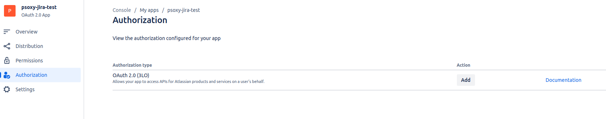
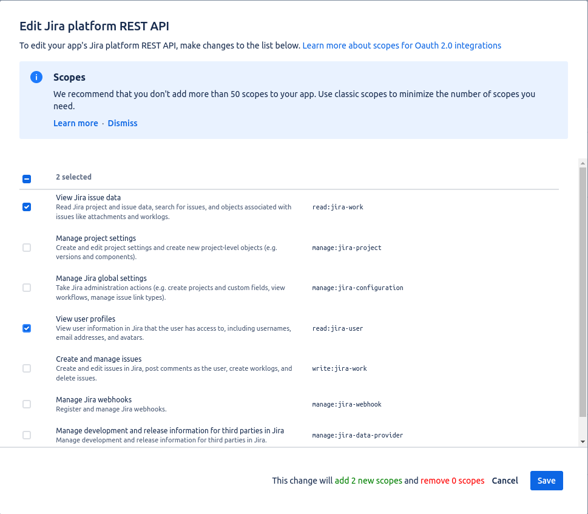
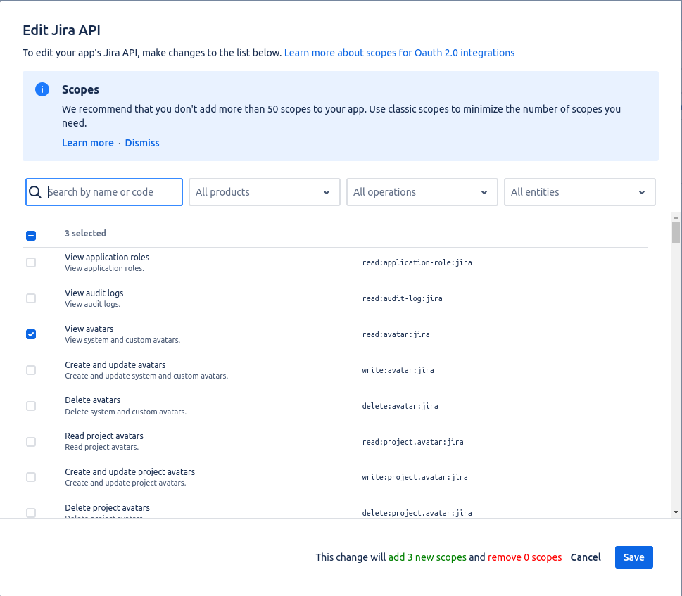
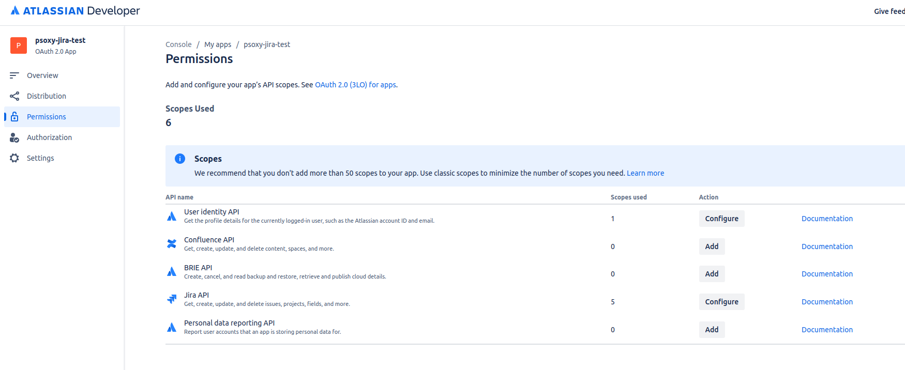
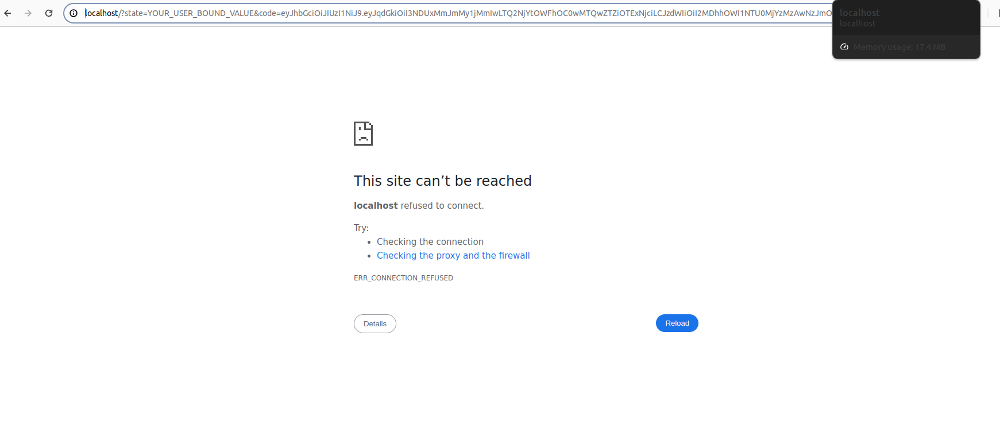

# Jira Cloud

**Connector ID:** `jira-cloud-service-account`

**Availability:** GA

NOTE: This is for the Cloud-hosted version of Jira; for the self-hosted version, see [Jira Server](jira-server.md).

NOTE: These instructions are derived from [worklytics-connector-specs](../../../../infra/modules/worklytics-connector-specs/main.tf); refer to that for definitive information.

## Prerequisites

Jira Cloud through Psoxy authenticates using an [Atlassian OAuth 2.0 credential for a service
account](https://support.atlassian.com/user-management/docs/create-oauth-2-0-credential-for-service-accounts/)
(a "2LO"/`client_credentials` grant). This requires:

- Your Atlassian organization must be on the **centralized user management** experience
  (`admin.atlassian.com`). Org admin access is required to create the service account and its
  credential.
- A **service account** (orgs get 5 free; more available via Atlassian Guard/Enterprise) granted
  the `User` role on the Jira site you want to connect.

Granting the service account the `User` role on Jira grants an OAuth 2.0 credential created for it
the following scopes, which is what Psoxy needs:

| Scope | Purpose |
| --- | --- |
| `read:jira-user` | for getting [users](https://developer.atlassian.com/cloud/jira/platform/rest/v3/api-group-users/#api-rest-api-3-users-search-get) |
| `read:jira-work` | for getting information about [issues](https://developer.atlassian.com/cloud/jira/platform/rest/v3/api-group-issues/#api-rest-api-3-issue-issueidorkey-get), [issue search](https://developer.atlassian.com/cloud/jira/platform/rest/v3/api-group-issue-search/#api-rest-api-3-search-jql-get), [changelogs](https://developer.atlassian.com/cloud/jira/platform/rest/v3/api-group-issues/#api-rest-api-3-issue-issueidorkey-changelog-get), [comments](https://developer.atlassian.com/cloud/jira/platform/rest/v3/api-group-issue-comments/#api-rest-api-3-issue-issueidorkey-comment-get), [projects](https://developer.atlassian.com/cloud/jira/platform/rest/v3/api-group-projects/#api-rest-api-3-project-search-get) and [worklogs](https://developer.atlassian.com/cloud/jira/platform/rest/v3/api-group-issue-worklogs/#api-rest-api-3-issue-issueidorkey-worklog-get) |
| `read:group:jira` | for retrieving [groups](https://developer.atlassian.com/cloud/jira/platform/rest/v3/api-group-groups/#api-rest-api-3-group-bulk-get) |
| `read:user:jira` | for retrieving [group members](https://developer.atlassian.com/cloud/jira/platform/rest/v3/api-group-groups/#api-rest-api-3-group-member-get) |
| `read:avatar:jira` | for retrieving avatars referenced in the above |

You will need a web browser for the one-time service account/credential setup in
`admin.atlassian.com`.

## Setup Instructions

1. Go to [https://admin.atlassian.com](https://admin.atlassian.com), select your organization, then
   "Directory" > "Service accounts".

   

2. Click "Create a service account". Give it a name (6-30 characters, e.g. `proxy_sa`) and an
   optional description, then continue to "Select app roles".

   

   **NOTE** You can't change a service account's email after creation, and orgs get 5 free service
   accounts before requiring Atlassian Guard/Enterprise - plan the account name accordingly.

3. In the app roles table, find "Jira" and set its role to `User`. (If you also plan to connect
   [Confluence Cloud](../confluence/README.md) with this same service account, set its role too.)
   Finish creating the account.

   

4. From the service account's page, click "Create credentials".

   

5. Choose "OAuth 2.0" as the authentication type (the recommended option) and continue.

   

6. On the review screen, confirm the listed scopes match the list in Prerequisites above - granting
   the `User` role on Jira alone produces exactly this set.

   

   **NOTE** Scopes are set by the app role(s) granted in step 3; you can't hand-pick scopes here, and
   once the credential is created you can't modify it - revoke and re-create it if you need to
   change the role/scopes later.

7. Create the credential, then immediately copy the "Client ID" and "Client secret" - they are
   **shown only once** and can't be recovered afterwards.

   

8. Set the following variables in AWS System Manager parameters store / GCP Cloud Secrets (if
   default implementation):
   - `PSOXY_JIRA_CLOUD_SERVICE_ACCOUNT_CLIENT_ID` with the "Client ID" value.
   - `PSOXY_JIRA_CLOUD_SERVICE_ACCOUNT_CLIENT_SECRET` with the "Client secret" value.

That's all that's needed to run the connector - no refresh token, and no further interaction with
Atlassian is required afterwards (Psoxy exchanges the client ID/secret for short-lived access
tokens automatically, as needed).

### Optional: Cloud ID, for generating example/test API call URLs

The Jira Cloud ID is **not** required for the connector to authenticate or run - it's only used by
Terraform to generate example/test API call URLs. If you want those, run
[`tools/jira-cloud-id.sh`](../../../../tools/jira-cloud-id.sh) (give it your site's URL,
e.g. `https://your-site.atlassian.net`) and set the Cloud ID it prints as the value of the
`jira_cloud_id` variable in your `connector_settings` in `terraform.tfvars` (e.g.
`connector_settings = { jira_cloud_id = "..." }`).

If you'd rather not use the script, you can get the same value yourself - no credentials needed:

```shell
curl https://your-site.atlassian.net/_edge/tenant_info
```

which returns `{"cloudId": "SOME-UUID", ...}` (or just open that URL in a browser). Use the
`cloudId` value the same way as above.

Example API call path parameters (uppercase placeholders in generated test calls):

- `{CLOUD_ID}`: the Jira Cloud id (`connector_settings.jira_cloud_id`, see above).
- `{ISSUE_ID}`: a Jira issue key or id (`connector_settings.jira_example_issue_id`), e.g. `ETV-12`.
- `{GROUP_ID}`: a group id from `GET .../group/bulk` (query param on `/group/member`).

---

## Deprecated: Jira Cloud (3LO)

**Connector ID:** `jira-cloud`

**Availability:** Deprecated - to be removed (or have its auth scheme replaced) in the next major
version; see `CHANGELOG.md`.

This connector uses a user-delegated OAuth 2.0 (3LO) `refresh_token` flow, which requires
re-authorizing (repeating the browser-consent steps below) at least annually, since Atlassian caps
a 3LO "token family" at a 1-year max lifetime. **New connections should use [Jira Cloud](#jira-cloud)
above (`jira-cloud-service-account`) instead**, which authenticates via an Atlassian OAuth 2.0
service account credential with no refresh token or annual renewal. `jira-cloud` remains fully
supported for existing deployments.

### Prerequisites

Jira Cloud through Psoxy uses Jira OAuth 2.0 (3LO) with following classical scopes:
- `read:jira-user`: for getting [users](https://developer.atlassian.com/cloud/jira/platform/rest/v3/api-group-users/#api-rest-api-3-users-search-get)
- `read:jira-work`: for getting information about [issue](https://developer.atlassian.com/cloud/jira/platform/rest/v3/api-group-issues/#api-rest-api-3-issue-issueidorkey-get), [issue search](https://developer.atlassian.com/cloud/jira/platform/rest/v3/api-group-issue-search/#api-rest-api-3-search-jql-get), [changelogs](https://developer.atlassian.com/cloud/jira/platform/rest/v3/api-group-issues/#api-rest-api-3-issue-issueidorkey-changelog-get), [comments](https://developer.atlassian.com/cloud/jira/platform/rest/v3/api-group-issue-comments/#api-rest-api-3-issue-issueidorkey-comment-get), [projects](https://developer.atlassian.com/cloud/jira/platform/rest/v3/api-group-projects/#api-rest-api-3-project-search-get) and [worklogs](https://developer.atlassian.com/cloud/jira/platform/rest/v3/api-group-issue-worklogs/#api-rest-api-3-issue-issueidorkey-worklog-get)

And following granular scopes:
- `read:user:jira`: for retrieving [group members](https://developer.atlassian.com/cloud/jira/platform/rest/v3/api-group-groups/#api-rest-api-3-group-member-get)
- `read:group:jira`: for retrieving [groups](https://developer.atlassian.com/cloud/jira/platform/rest/v3/api-group-groups/#api-rest-api-3-group-bulk-get) and [group members](https://developer.atlassian.com/cloud/jira/platform/rest/v3/api-group-groups/#api-rest-api-3-group-member-get)
- `read:avatar:jira`: for retrieving [group members](https://developer.atlassian.com/cloud/jira/platform/rest/v3/api-group-groups/#api-rest-api-3-group-member-get)

You will need a web browser and a terminal with `curl` available (such as macOS terminal, Linux, an AWS Cloud Shell, [Windows Subsystem for Linux](https://learn.microsoft.com/en-us/windows/wsl/install), etc)

### Setup Instructions

1. Go to [https://developer.atlassian.com/console/myapps/](https://developer.atlassian.com/console/myapps/) and click on "Create" and choose "OAuth 2.0 Integration"
2. Then click "Authorization" and "Add" on `OAuth 2.0 (3L0)`, adding `http://localhost` as callback URI. It can be any URL that matches the URL format and it is required to be populated, but the proxy instance workflow will not use it.

   

3. Now navigate to "Permissions" and click on "Add" for `Jira API`. Once added, click on "Configure". Add following scopes as part of "Classic Scopes", first clicking on `Edit Scopes` and then selecting them:
   - `read:jira-user`
   - `read:jira-work`

   

   And these from "Granular Scopes":
   - `read:group:jira`
   - `read:avatar:jira`
   - `read:user:jira`

  


   After adding all the scopes, you should have 5 permissions for `Jira API`:

  

4. Once Configured, go to "Settings" and copy the "Client Id" and "Secret". You will use these to obtain an OAuth `refresh_token`.

5. Build an OAuth authorization endpoint URL by copying the value for "Client Id" obtained in the previous step into the URL below. Then open the result in a web browser:

`https://auth.atlassian.com/authorize?audience=api.atlassian.com&client_id=<CLIENT ID>&scope=offline_access%20read:group:jira%20read:avatar:jira%20read:user:jira%20read:jira-user%20read:jira-work&redirect_uri=http://localhost&state=YOUR_USER_BOUND_VALUE&response_type=code&prompt=consent`

     NOTES:
     - That URL can be obtained from "Authorization" and clicking on `Configure` for  "OAuth 2.0 (3LO)" page.
     - If after pasting the URL you see an error page (like an issue with identity provider) please check:
       1 - The `clientId` is correct
       2 - The `redirect_uri` is the same as the one configured in the "OAuth 2.0 (3LO)" page

6. Choose a site in your Jira workspace to allow access for this application and click "Accept". As the callback does not exist, you will see an error. But in the URL of your browser you will see something like this as URL:

   `http://localhost/?state=YOUR_USER_BOUND_VALUE&code=eyJhbGc...`

   Copy the value of the `code` parameter from that URI. It is the "authorization code" required for next step.

   

   **NOTE** This "Authorization Code" is single-use; if it expires or is used, you will need to obtain a new code by again pasting the authorization URL in the browser.
7. Now, replace the values in following URL and run it from command line in your terminal. Replace `YOUR_AUTHENTICATION_CODE`, `YOUR_CLIENT_ID` and `YOUR_CLIENT_SECRET` in the placeholders:

```shell
curl --request POST --url 'https://auth.atlassian.com/oauth/token' --header 'Content-Type: application/json' --data '{"grant_type": "authorization_code","client_id": "YOUR_CLIENT_ID","client_secret": "YOUR_CLIENT_SECRET", "code": "YOUR_AUTHENTICATION_CODE", "redirect_uri": "http://localhost"}'
```


8. After running that command, if successful you will see a
   [JSON response](https://developer.atlassian.com/cloud/jira/platform/oauth-2-3lo-apps/#2--exchange-authorization-code-for-access-token)
   like this:

```json
{
	"access_token": "some short live access token",
	"expires_in": 3600,
	"token_type": "Bearer",
	"refresh_token": "some long live token we are going to use",
	"scope": "read:jira-work offline_access read:jira-user"
}
```
9. Set the following variables in AWS System Manager parameters store / GCP Cloud Secrets (if default implementation):
   - `PSOXY_JIRA_CLOUD_REFRESH_TOKEN` secret variable with value of `refresh_token` received in previous response
   - `PSOXY_JIRA_CLOUD_CLIENT_ID` with `Client Id` value.
   - `PSOXY_JIRA_CLOUD_CLIENT_SECRET` with `Client Secret` value.
10. Obtain the "Cloud ID" of your Jira instance. Use the following command, with the `access_token` obtained in the previous step in place of `<ACCESS_TOKEN>` below:

`curl --header 'Authorization: Bearer <ACCESS_TOKEN>' --url 'https://api.atlassian.com/oauth/token/accessible-resources'`

And its response will be something like:

```json
[
	{
		"id": "SOME UUID",
		"url": "https://your-site.atlassian.net",
		"name": "your-site-name",
		"scopes": ["read:jira-user", "read:jira-work"],
		"avatarUrl": "https://site-admin-avatar-cdn.prod.public.atl-paas.net/avatars/240/rocket.png"
	}
]
```

In your Terraform configuration's `terraform.tfvars` file, set the `jira_cloud_id` variable in your `connector_settings` to the `id` value from the JSON response (e.g. `connector_settings = { jira_cloud_id = "..." }`). This will ensure that all **test URLs** are generated with the correct value, targeting a valid Jira Cloud instance.

Example API call path parameters (uppercase placeholders in generated test calls):

- `{CLOUD_ID}`: the Jira Cloud id from `GET /oauth/token/accessible-resources` (`connector_settings.jira_cloud_id`).
- `{ISSUE_ID}`: a Jira issue key or id (`connector_settings.jira_example_issue_id`), e.g. `ETV-12`.
- `{GROUP_ID}`: a group id from `GET .../group/bulk` (query param on `/group/member`).

NOTE: A "token family" includes the initial access/refresh tokens generated above as well as all subsequent access/refresh tokens that Jira returns to any future token refresh requests. By default, Jira enforces a maximum lifetime of 1 year for each **token family**. So you MUST repeat steps 5-9 at least annually or your proxy instance will stop working when the token family expires.
