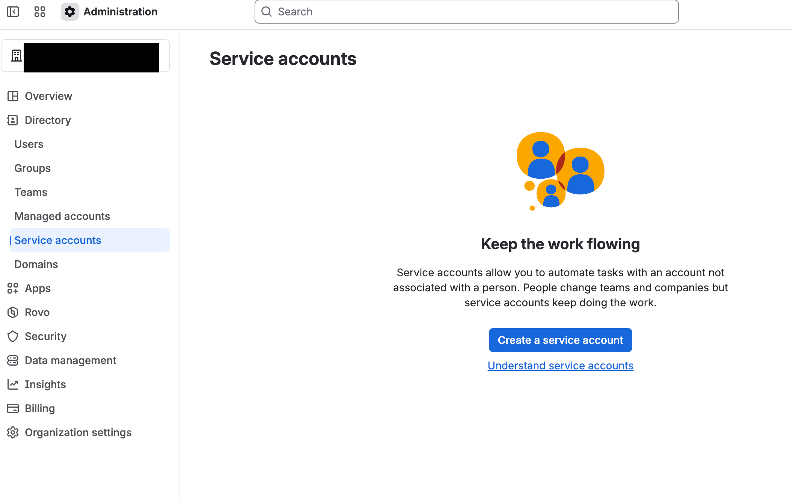
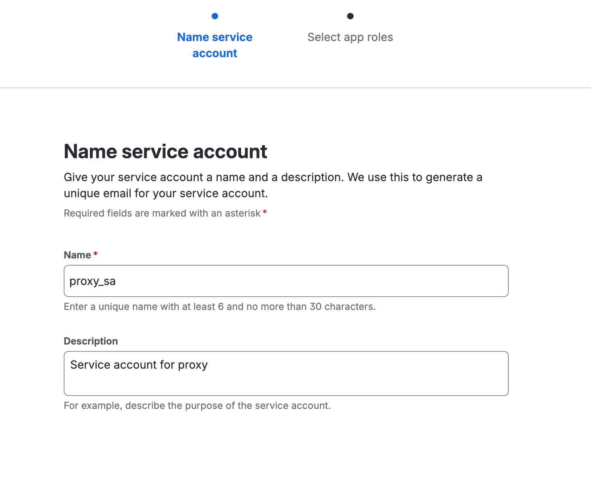
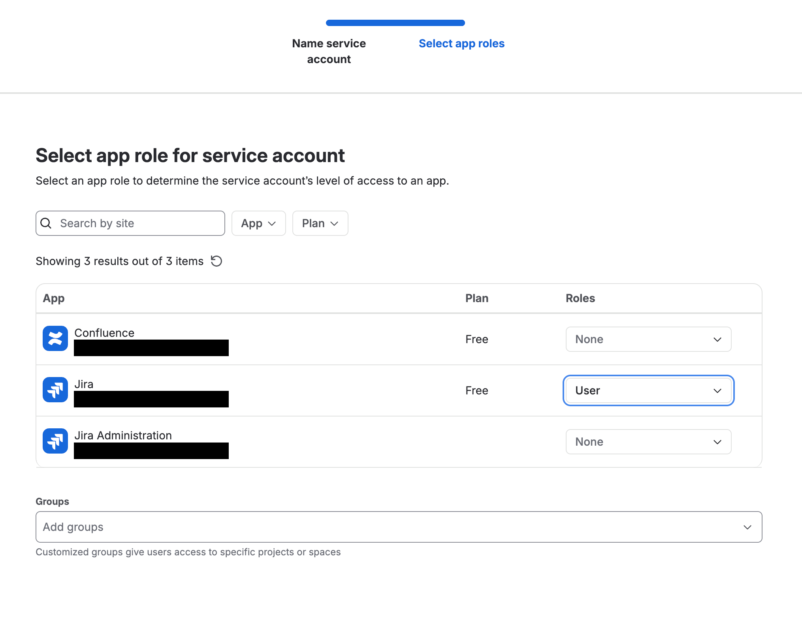
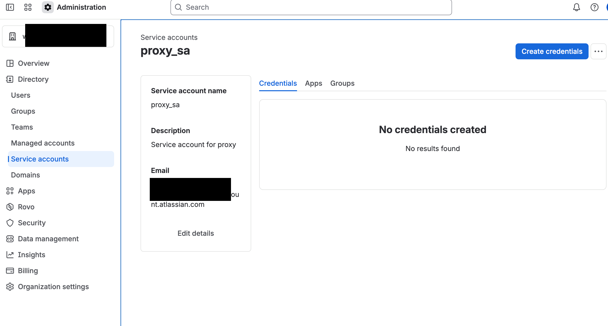
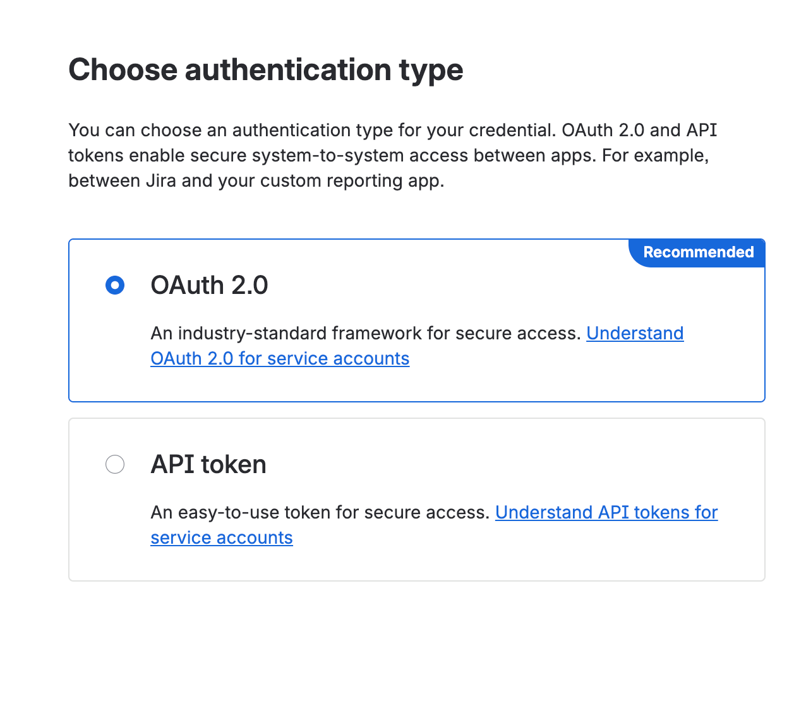
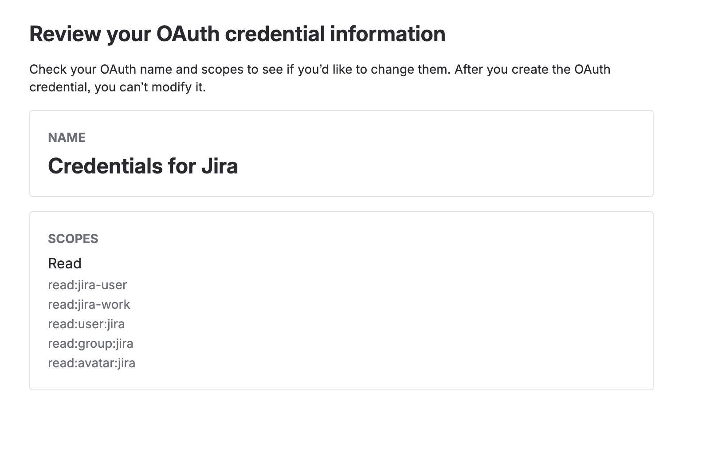
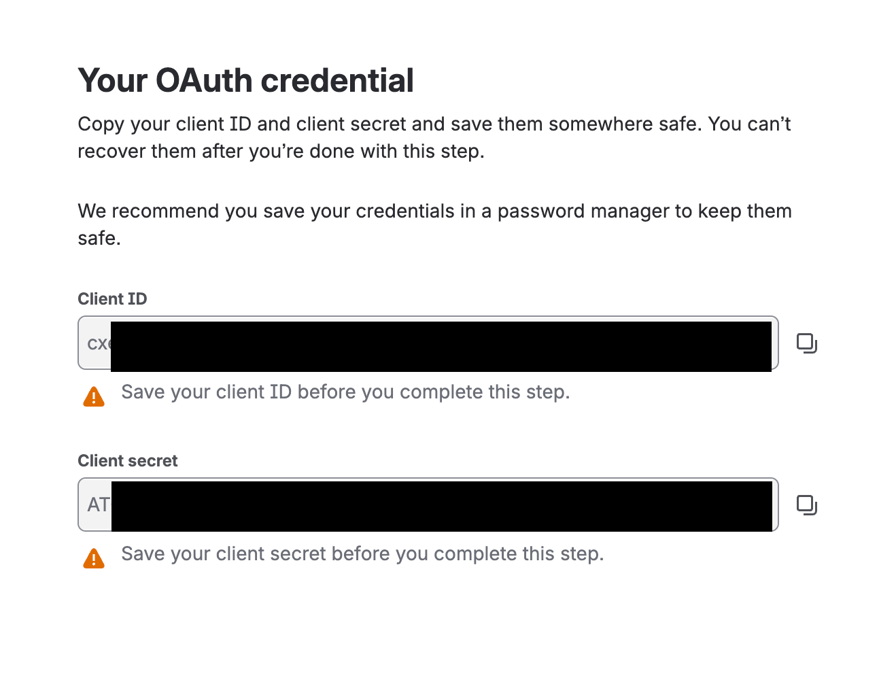

# Jira Cloud (Service Account)

**Connector ID:** `jira-cloud-service-account`

**Availability:** GA

NOTE: This is for the Cloud-hosted version of Jira; for the self-hosted version, see [Jira Server](jira-server.md).

NOTE: This connector uses the same rules/data shape as [`jira-cloud`](README.md) - it differs only
in how Psoxy authenticates to Jira (an Atlassian OAuth 2.0 service account credential, instead of a
user-delegated 3LO `refresh_token`). We recommend new connections use this one; see
[`jira-cloud`](README.md) for background on why it's being phased out.

NOTE: These instructions are derived from [worklytics-connector-specs](../../../../infra/modules/worklytics-connector-specs/main.tf); refer to that for definitive information.

## Prerequisites

Jira Cloud through Psoxy authenticates using an [Atlassian OAuth 2.0 credential for a service
account](https://support.atlassian.com/user-management/docs/create-oauth-2-0-credential-for-service-accounts/)
(a "2LO"/`client_credentials` grant). This requires:

- Your Atlassian organization must be on the **centralized user management** experience
  (`admin.atlassian.com`). Org admin access is required to create the service account and its
  credential.
- A **service account** (orgs get 5 free; more available via Atlassian Guard/Enterprise) granted
  the `User` role on the Jira site you want to connect.

Granting the service account the `User` role on Jira grants an OAuth 2.0 credential created for it
the following scopes, which is what Psoxy needs:

| Scope | Purpose |
| --- | --- |
| `read:jira-user` | for getting [users](https://developer.atlassian.com/cloud/jira/platform/rest/v3/api-group-users/#api-rest-api-3-users-search-get) |
| `read:jira-work` | for getting information about [issues](https://developer.atlassian.com/cloud/jira/platform/rest/v3/api-group-issues/#api-rest-api-3-issue-issueidorkey-get), [issue search](https://developer.atlassian.com/cloud/jira/platform/rest/v3/api-group-issue-search/#api-rest-api-3-search-jql-get), [changelogs](https://developer.atlassian.com/cloud/jira/platform/rest/v3/api-group-issues/#api-rest-api-3-issue-issueidorkey-changelog-get), [comments](https://developer.atlassian.com/cloud/jira/platform/rest/v3/api-group-issue-comments/#api-rest-api-3-issue-issueidorkey-comment-get), [projects](https://developer.atlassian.com/cloud/jira/platform/rest/v3/api-group-projects/#api-rest-api-3-project-search-get) and [worklogs](https://developer.atlassian.com/cloud/jira/platform/rest/v3/api-group-issue-worklogs/#api-rest-api-3-issue-issueidorkey-worklog-get) |
| `read:group:jira` | for retrieving [groups](https://developer.atlassian.com/cloud/jira/platform/rest/v3/api-group-groups/#api-rest-api-3-group-bulk-get) |
| `read:user:jira` | for retrieving [group members](https://developer.atlassian.com/cloud/jira/platform/rest/v3/api-group-groups/#api-rest-api-3-group-member-get) |
| `read:avatar:jira` | for retrieving avatars referenced in the above |

You will need a web browser for the one-time service account/credential setup in
`admin.atlassian.com`.

## Setup Instructions

1. Go to [https://admin.atlassian.com](https://admin.atlassian.com), select your organization, then
   "Directory" > "Service accounts".

   

2. Click "Create a service account". Give it a name (6-30 characters, e.g. `proxy_sa`) and an
   optional description, then continue to "Select app roles".

   

   **NOTE** You can't change a service account's email after creation, and orgs get 5 free service
   accounts before requiring Atlassian Guard/Enterprise - plan the account name accordingly.

3. In the app roles table, find "Jira" and set its role to `User`. (If you also plan to connect
   [Confluence Cloud](../confluence/README.md) with this same service account, set its role too.)
   Finish creating the account.

   

4. From the service account's page, click "Create credentials".

   

5. Choose "OAuth 2.0" as the authentication type (the recommended option) and continue.

   

6. On the review screen, confirm the listed scopes match the list in Prerequisites above - granting
   the `User` role on Jira alone produces exactly this set.

   

   **NOTE** Scopes are set by the app role(s) granted in step 3; you can't hand-pick scopes here, and
   once the credential is created you can't modify it - revoke and re-create it if you need to
   change the role/scopes later.

7. Create the credential, then immediately copy the "Client ID" and "Client secret" - they are
   **shown only once** and can't be recovered afterwards.

   

8. Set the following variables in AWS System Manager parameters store / GCP Cloud Secrets (if
   default implementation):
   - `PSOXY_JIRA_CLOUD_SERVICE_ACCOUNT_CLIENT_ID` with the "Client ID" value.
   - `PSOXY_JIRA_CLOUD_SERVICE_ACCOUNT_CLIENT_SECRET` with the "Client secret" value.

That's all that's needed to run the connector - no refresh token, and no further interaction with
Atlassian is required afterwards (Psoxy exchanges the client ID/secret for short-lived access
tokens automatically, as needed).

### Optional: Cloud ID, for generating example/test API call URLs

The Jira Cloud ID is **not** required for the connector to authenticate or run - it's only used by
Terraform to generate example/test API call URLs. If you want those, run
[`tools/jira-cloud-id.sh`](../../../../tools/jira-cloud-id.sh) (give it your site's URL,
e.g. `https://your-site.atlassian.net`) and set the Cloud ID it prints as the value of the
`jira_cloud_id` variable in your `connector_settings` in `terraform.tfvars` (e.g.
`connector_settings = { jira_cloud_id = "..." }`).

If you'd rather not use the script, you can get the same value yourself - no credentials needed:

```shell
curl https://your-site.atlassian.net/_edge/tenant_info
```

which returns `{"cloudId": "SOME-UUID", ...}` (or just open that URL in a browser). Use the
`cloudId` value the same way as above.

Example API call path parameters (uppercase placeholders in generated test calls):

- `{CLOUD_ID}`: the Jira Cloud id (`connector_settings.jira_cloud_id`, see above).
- `{ISSUE_ID}`: a Jira issue key or id (`connector_settings.jira_example_issue_id`), e.g. `ETV-12`.
- `{GROUP_ID}`: a group id from `GET .../group/bulk` (query param on `/group/member`).
